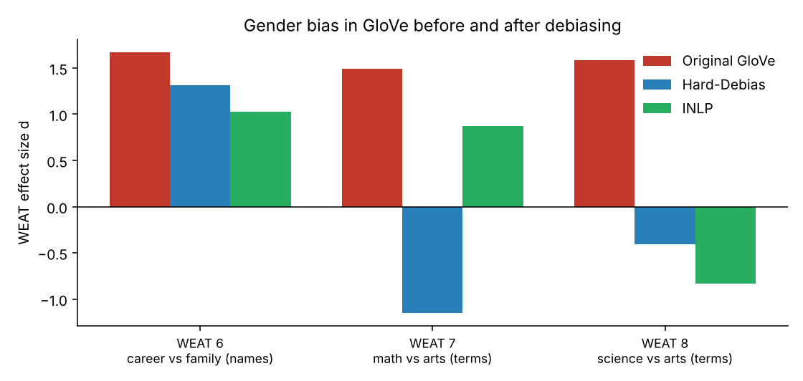

# ⚖️ Gender Bias in Embeddings & Transformers: Detection and Mitigation

Code accompanying my research at the **University of East Anglia** (NLP Research Intern, 2022) and the review paper
*"Gender Bias in Transformers: A Comprehensive Review of Detection and Mitigation Strategies"* (Natural Language Processing Journal, Elsevier).

It implements:

- **Detection:** WEAT (Caliskan et al., 2017) with permutation tests, and SEAT (May et al., 2019) for contextual encoders
- **Mitigation:** Hard-Debias (Bolukbasi et al., 2016), INLP (Ravfogel et al., 2020) and Counterfactual Data Augmentation (Lu et al., 2018)
- **Evaluation of trade-offs:** how much semantic structure each mitigation destroys

## 📊 Results on GloVe (measured, reproducible)



| Test | Original d (p) | Hard-Debias d (p) | INLP d (p) |
|---|---|---|---|
| WEAT 6: career vs family (names) | **+1.67** (0.000) | +1.31 (0.004) | +1.03 (0.018) |
| WEAT 7: math vs arts (terms) | **+1.50** (0.000) | −1.15 (0.992) | +0.87 (0.042) |
| WEAT 8: science vs arts (terms) | **+1.59** (0.000) | −0.41 (0.774) | −0.83 (0.952) |
| *Utility: neighbour overlap@10* | 1.00 | 0.89 | 0.81 |

GloVe wiki-gigaword 50d, top 50k words, 10,000 permutations. Full output: [`results/static_weat.md`](results/static_weat.md).

**Findings**

1. GloVe encodes large, significant gender stereotypes (|d| ≈ 1.5–1.7), consistent with Caliskan et al.
2. **Hard-Debias overshoots.** Equalizing gendered pairs flips WEAT 7 to a *reverse* bias (−1.15) and barely moves the name-based test, because names are not in the definitional set.
3. **INLP** removes linear gender information (probe accuracy 1.00 → 0.55) but leaves significant bias on two of three tests and costs more semantic structure (neighbour overlap 0.81).
4. Post-hoc projection methods treat symptoms. Bias that persists through non-linear or name-based associations is consistent with Gonen & Goldberg (2019), "Lipstick on a Pig". This motivates data-level methods such as **CDA**, and evaluation with several metrics rather than WEAT alone.

## 🤖 Transformers (BERT, GPT-2, RoBERTa, XLNet)

```bash
pip install torch transformers datasets
python experiments/run_transformers.py --models bert-base-uncased gpt2 roberta-base xlnet-base-cased
python experiments/cda_finetune.py --model bert-base-uncased --corpus corpus.txt --out models/bert-cda
python experiments/run_transformers.py --models models/bert-cda          # bias after CDA
```

SEAT inserts each word into neutral templates ("This is ⟨word⟩.") and mean-pools token states. The CDA script continues masked-language-model training on a corpus where every sentence is paired with a gender-swapped copy.
*These scripts need HuggingFace model downloads, so their outputs aren't committed here.*

## 🚀 Reproduce the GloVe results

```bash
pip install -r requirements.txt
curl -L -o data/glove-wiki-gigaword-50.gz \
  https://github.com/RaRe-Technologies/gensim-data/releases/download/glove-wiki-gigaword-50/glove-wiki-gigaword-50.gz
python experiments/run_static.py          # about 5 minutes on a laptop CPU
pytest -q                                 # 5 unit tests
```

## 🧩 Code map

```
genderbias/weat.py          WEAT effect size + permutation p-value
genderbias/debias.py        gender direction (PCA), Hard-Debias (neutralize + equalize), INLP
genderbias/cda.py           counterfactual gender swapping (case-preserving, his/him disambiguation for "her")
genderbias/embeddings.py    GloVe loader, transformer sentence encoder for SEAT
genderbias/wordlists.py     Caliskan WEAT 6-8 word sets, Bolukbasi definitional/equalize pairs
experiments/                static (GloVe) and transformer experiments, CDA fine-tuning
tests/                      planted-bias detection, null case, antisymmetry, debias projection, CDA
```

## 📚 References

Caliskan et al. 2017 (Science) · Bolukbasi et al. 2016 (NeurIPS) · May et al. 2019 (NAACL) · Ravfogel et al. 2020 (ACL) · Lu et al. 2018 · Zmigrod et al. 2019 (ACL) · Gonen & Goldberg 2019 (NAACL)

**Tech:** Python · NumPy · scikit-learn · HuggingFace Transformers · PyTorch
